<p align="center"></p>
<h1 align="center">Pocket Family</h1>
<p align="center">The whole household in one place: who picks up the children today (and who can take it when you can't), the family's week next to everyone's own calendar, chores in turns with stars for the kids, shared shopping lists, letters from school read for you, and what the sitter needs to know. One Go binary, one SQLite file, one volume. Part of the Pocket apps; works on its own too.</p>
<p align="center">
  <a href="https://github.com/abjelosevic88/pocket-homelab-family/actions/workflows/ci.yml"></a>
  <a href="https://github.com/abjelosevic88/pocket-homelab-family/pkgs/container/pocket-homelab-family"></a>
  <a href="LICENSE"></a>
</p>

<p align="center">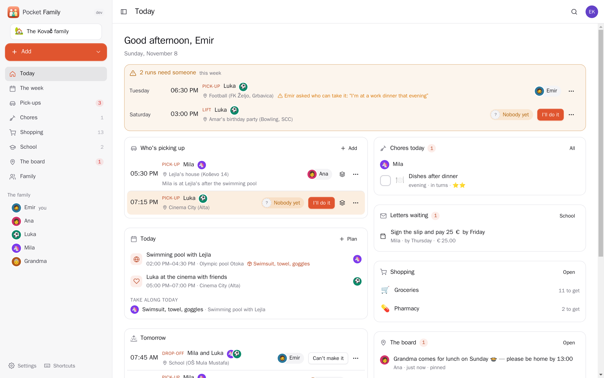</p>

<table>
  <tr>
    <td width="50%">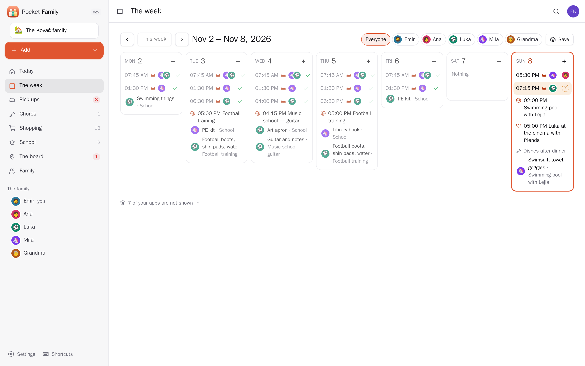</td>
    <td width="50%">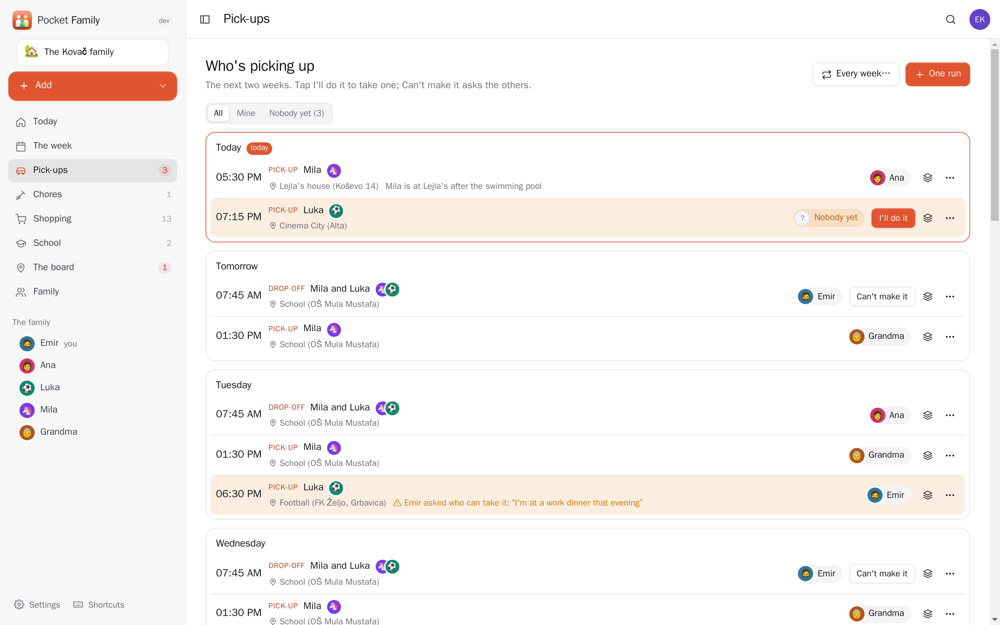</td>
  </tr>
  <tr>
    <td align="center"><sub>The week: runs, plans, chores and what to take along, for everyone or one person.</sub></td>
    <td align="center"><sub>“I'll do it”, “Can't make it”: the school run on a weekly rota that skips the holidays.</sub></td>
  </tr>
  <tr>
    <td width="50%">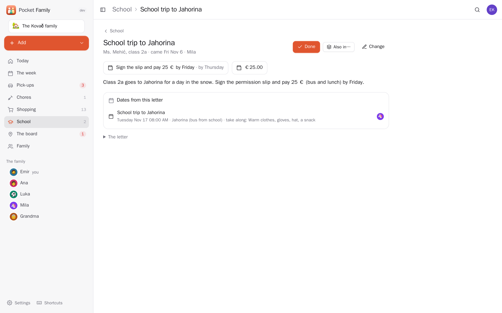</td>
    <td width="50%">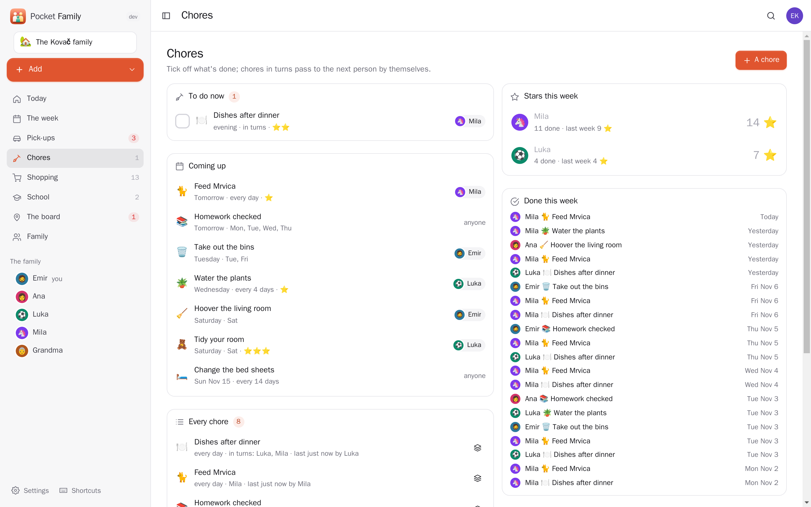</td>
  </tr>
  <tr>
    <td align="center"><sub>A letter from school: what to sign, pay and take along, its dates on the week, the payment into Pocket Money.</sub></td>
    <td align="center"><sub>Chores for one, in turns or for anyone; stars for the children.</sub></td>
  </tr>
  <tr>
    <td width="50%">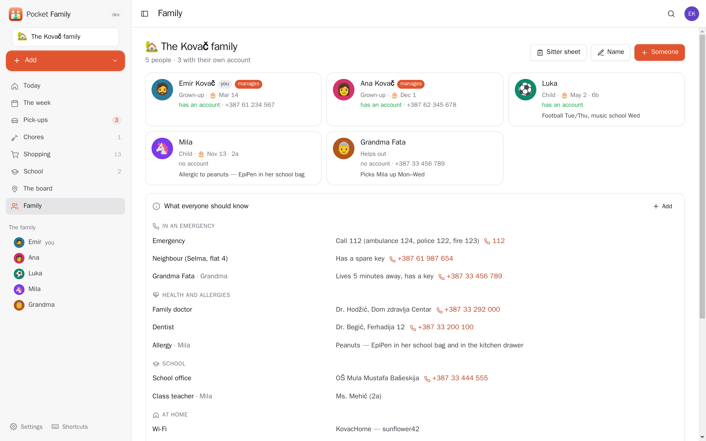</td>
    <td width="50%">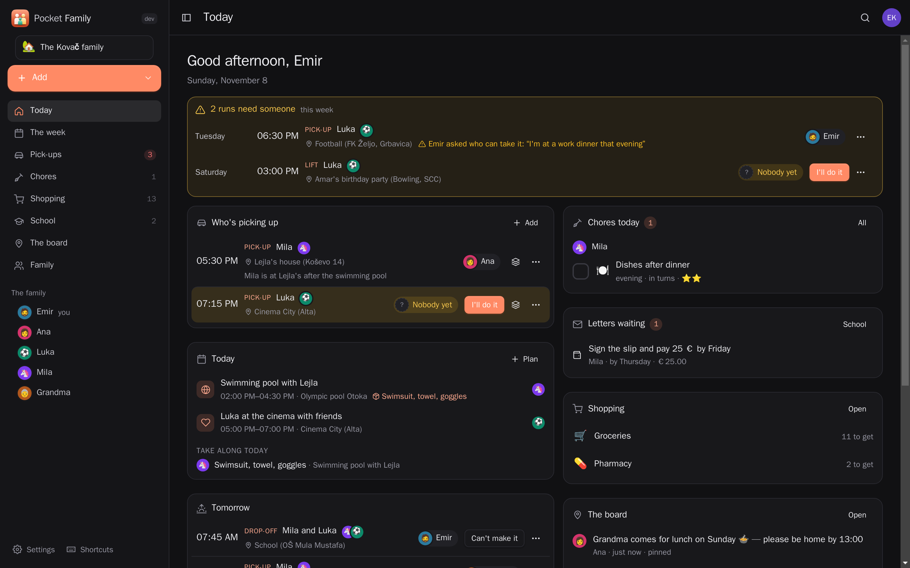</td>
  </tr>
</table>

<p align="center">
  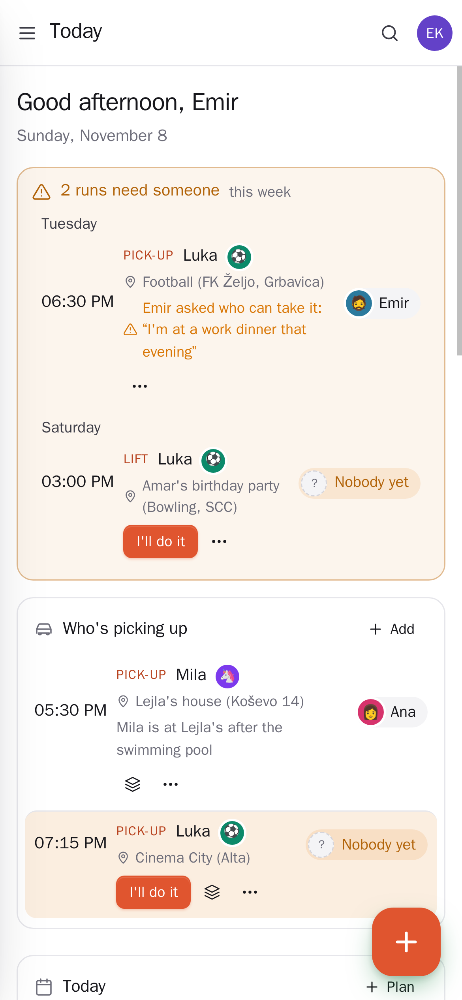
  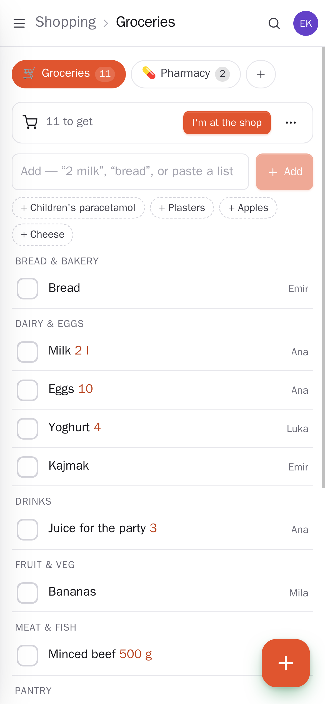
  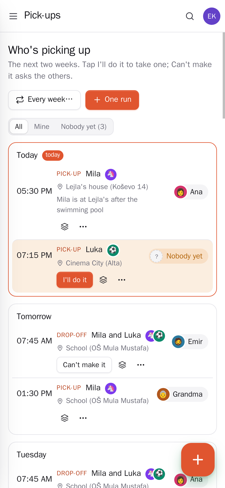
  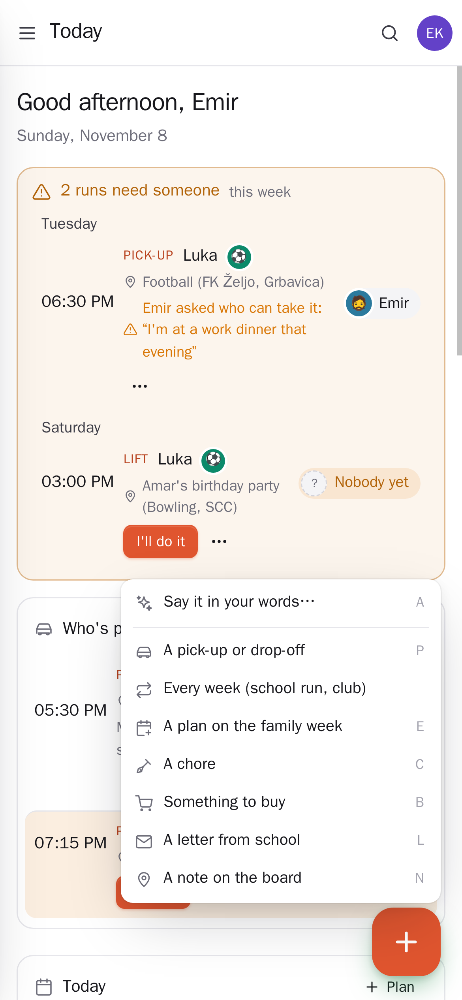
</p>

## What it does

- **Who's picking up**: pick-ups, drop-offs and lifts, one-off or every week (with a different grown-up per weekday, and not in school holidays). “I'll do it” takes one; “Can't make it” asks the others, who get a push and take it with one tap. Two places at once and runs nobody has taken are shown plainly.
- **Today and the week**: the family's plans next to each person's own Pocket Calendar, sport games (Pocket League), trips (Pocket Travel), dinner (Pocket Kitchen), the weather (Pocket Weather), the pets' and the home's care due, relatives' birthdays (Pocket Contacts) and papers running out (Pocket Renewals). What each child takes to school tomorrow.
- **Chores**: for one person, in turns (passed on by itself) or for anyone; daily, on weekdays, every few days, monthly or once. Children tick off their own and earn stars.
- **Shopping**: shared lists in the order of a shop, “2 milk” or a pasted list, nothing twice, “I'm at the shop” tells the others; the meal plan's ingredients from Pocket Kitchen in one tap.
- **School**: letters from school or a club — paste one and Pocket AI picks out the dates, what to sign, pay and take along (you check it first); each child's school week; terms, holidays and closed days.
- **The board** for notes to everyone, with who has seen them; **the family info** (who to call, allergies, the doctor, the wifi) and a **sitter sheet** to print.
- **Pocket AI** when you ask: read a letter, “say it in your words” (“Ana picks Mila up from football on Thursday at 6”), the week in a few lines.
- **Notifications** to your own address (Pocket Alerts, ntfy, Apprise): a pick-up given to you or needing someone, someone at the shop, new notes, and “tomorrow for you” the evening before.
- **Private by design**: a family is seen only by the people in it — admins manage accounts, they do not see anyone's family. Children can have accounts (they tick chores and add to lists, they don't plan). A person can be in two families.

## Run it

```sh
docker run -d --name pocket-family -p 8080:8080 -v ./data:/data \
  -e BASE_URL=https://family.example.com -e SECURE_COOKIES=true \
  -e ADMIN_EMAIL=you@example.com -e ADMIN_PASSWORD=change-me-please \
  ghcr.io/abjelosevic88/pocket-homelab-family:latest
```

Or a release binary (`pocket-family`), or `make run` for a demo with a busy family (`DEMO_DATA=true`). Configuration: [docs/configuration.md](docs/configuration.md) · API: [docs/api.md](docs/api.md) · Backups: [docs/backup.md](docs/backup.md).

## With Pocket Core

Set `CORE_URL` and `CORE_REGISTRATION_KEY` and Family joins the box: people sign in with Pocket Core, Pocket AI reads letters and plans with you, and each person's own app links let Family read and make things in their apps (switched on per person in Pocket Core; without them the option is greyed with what to do).

| App | What Family does with it | Scopes |
|---|---|---|
| Pocket Calendar | Your events on Today and the week; a run, a plan or a letter's date into your calendar | `calendar:read`, `calendar:write` |
| Pocket Tasks | A letter or a chore as a task | `tasks:read`, `tasks:write` |
| Pocket Contacts | Relatives' birthdays; the doctor or sitter for the info; someone from the family into your contacts | `contacts:read`, `contacts:write` |
| Pocket Kitchen | Dinner on Today and the week; the meal plan's ingredients onto a list | `plan:read`, `recipes:read` |
| Pocket Money | A school trip or club fee booked on an account | `accounts:read`, `transactions:write` |
| Pocket Split | A child's costs shared with the other parent | `groups:read`, `expenses:write` |
| Pocket Notes | The sitter sheet, a letter or the week as a note | `notes:write` |
| Pocket Weather · League · Travel · Pets · Home · Renewals | The weather, games, trips, care due and papers running out on Today and the week | `weather:read`, `league:read`, `trips:read`, `pets:read`, `home:read`, `renewals:read` |
| Pocket Chat | A note or a run told to your family chat, when you ask | `chat:read`, `chat:write` |

Other apps can use your family too (`family:read`: Pocket AI answers “who picks up Mila today?”, Pocket Day writes the family's day into your journal; `family:write`: Pocket AI, Voice or Flows add to the shopping list, a plan or a pick-up). Events: `family.run_needs_cover`, `family.run_taken`, `family.run_done`, `family.chore_done`, `family.post_added`, `family.letter_added`, `family.shopping_trip`.

## Build

```sh
make            # web + binary
make test       # go vet, go test, tsc
make run        # demo on :8080 (DEMO_DATA, AUTH_MODE=none)
```

MIT © 2026 Aleksandar Bjelosevic
